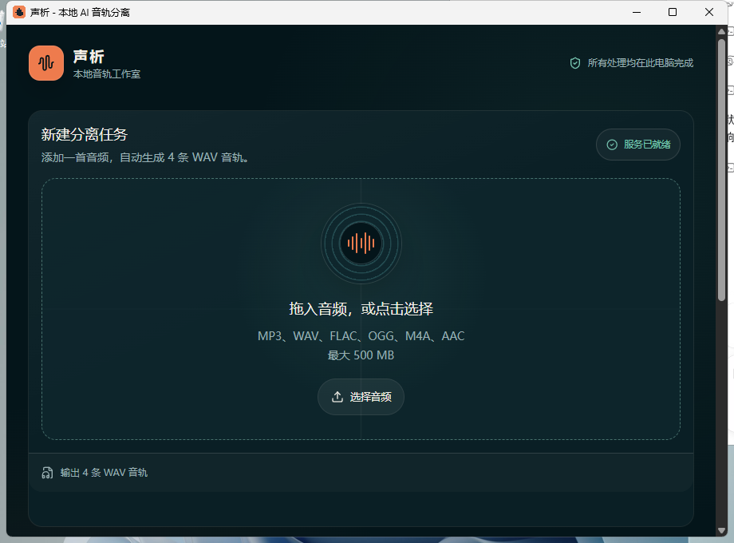

# 🎙️ ShengXi (vocal-separator) · Local AI Audio & Stem Separator

<p align="center">
  
</p>

<p align="center">
  <b>High-Fidelity AI Stem Separation Powered by Meta Demucs</b><br>
  Extract clean vocals, instrumentals, drums, and bass in one click · For musicians, DJs, karaoke, and audio creators<br>
  100% Local Processing · No Cloud Uploads · Unlimited Songs · Free & Open-Source
</p>

<p align="center">
  <b>English</b> | <a href="./README.md">简体中文</a>
</p>

<p align="center">
  
  
  
  
  
  
</p>

---

## 🎯 Highlights & Features

- **2-Stem & 4-Stem Modes**:
  - *2-Stem*: Clean Vocals + Instrumental (Karaoke accompaniment / Acapella).
  - *4-Stem*: Vocals + Drums + Bass + Other Instruments (Remixing, sampling, and music production).
- **GPU Acceleration**: Utilizes NVIDIA CUDA PyTorch acceleration with graceful CPU fallback.
- **100% Privacy & Offline**: All computations run locally on your machine. Unreleased songs, voiceovers, and stems never touch external servers.
- **Built-in Waveform Preview**: Seamlessly audition and toggle individual stems directly within the interactive desktop player.
- **Lossless Export**: Export stems to 24-bit lossless WAV, FLAC, or high-quality 320kbps MP3.
- **Batch Processing Queue**: Drag in multiple songs, reorder jobs, and monitor real-time progress.
- **AI Agent & MCP Ready**: Built-in FastAPI backend and Model Context Protocol (MCP) server for automated audio workflows.

---

## 🖥️ Preview

<p align="center">
  
</p>

---

## 🚀 Quick Start

### Option 1: Run Desktop Version (Recommended)
1. Double click **`start.bat`** (or the desktop executable shortcut).
2. Drag and drop your audio or video file into the window.
3. Choose **2-Stem** or **4-Stem** mode.
4. Click **Start Separation**!

### Option 2: Run from Source
```bash
git clone https://github.com/zhangtt08/vocal-separator.git
cd vocal-separator
npm install
python -m pip install -r backend/requirements.txt

# Start backend & frontend
python backend/main.py
npm run dev
```

---

## ⭐ Star & License

If you find ShengXi helpful, please consider giving it a **Star ⭐** on GitHub!
Licensed under the [MIT License](./LICENSE). Powered by Meta's [Demucs](https://github.com/adefossez/demucs).
